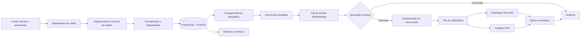

# AlertaSC

## Plataforma Inteligente para Monitoramento e Disseminação de Alertas de Desastres Naturais

> Especificação arquitetural do projeto. A Etapa 2 adiciona uma base executável local; os demais módulos descritos aqui continuam sendo visão futura e seguem as decisões aprovadas em `docs/etapa-1-condicoes-produto.md`.

O **AlertaSC** é uma plataforma para coletar, consolidar e disseminar informações sobre riscos meteorológicos, hidrológicos e geológicos em Santa Catarina.

## Executar a base local

A base executável atual usa exclusivamente dados sintéticos. Siga [o guia de configuração local](docs/etapa-2-execucao-local.md) para preparar o PostgreSQL/PostGIS, executar migrações, criar o operador sintético e iniciar frontend, API e worker.

Na fila, comunicados sintéticos aprovados e ainda válidos podem ser exportados em PNG/JPEG ou enviados ao seletor nativo para compartilhamento manual; veja [como a arte de demonstração é composta e quais limites respeita](docs/etapa-2-execucao-local.md#arte-visual-do-comunicado-aprovado). A aplicação não publica automaticamente em redes sociais.

O primeiro piloto será realizado em **Presidente Getúlio/SC**, com uma arquitetura preparada para expansão aos demais municípios do estado. A plataforma deverá reduzir o tempo entre a publicação de um aviso oficial e sua comunicação à população, mantendo revisão humana, rastreabilidade e histórico de todas as decisões.

## Objetivos

- Monitorar fontes oficiais e dados ambientais autorizados.
- Consolidar alertas, observações de estações, previsões e informações territoriais.
- Identificar municípios e áreas potencialmente afetadas.
- Gerar comunicados claros e acessíveis a partir dos dados recebidos.
- Permitir revisão, edição, aprovação e cancelamento por operadores autorizados.
- Publicar comunicados aprovados no Instagram profissional e no WhatsApp institucional.
- Permitir que moradores escolham municípios e tipos de evento de interesse.
- Registrar fonte, versão, horário, operador, canais e resultado de cada publicação.

## Princípio de segurança operacional

O AlertaSC **não será uma autoridade de emissão de alertas oficiais**. O sistema poderá criar uma ocorrência candidata com base em dados observacionais ou previsões, mas não publicará automaticamente um alerta de risco sem revisão e aprovação de um operador autorizado.

O conteúdo original recebido da fonte será preservado. Qualquer texto gerado ou editado pelo sistema será armazenado separadamente, permitindo comparar:

- informação original da fonte;
- interpretação normalizada pelo AlertaSC;
- texto revisado pelo operador;
- texto efetivamente enviado a cada canal.

## Referências

O projeto considera como referências funcionais e técnicas:

- [Proteção e Defesa Civil de Presidente Getúlio](https://pdc.presidentegetulio.sc.gov.br/), que apresenta monitoramento meteorológico, pluviométrico, fluviométrico, radar, previsão, abrigos e pedidos de ajuda;
- [Getúlio Atende Digital](https://github.com/leosoliz/getulio-atende-digital), que utiliza React, Vite, TypeScript, Tailwind CSS, componentes reutilizáveis e funções server-side;
- [Documentação de localidades do IBGE](https://www.ibge.gov.br/estatisticas/multidominio/ciencia-tecnologia-e-inovacao/27385-localidades.html?lang=pt-BR), para códigos e referências territoriais;
- documentação dos provedores oficiais listados na [matriz de fontes](#matriz-de-fontes-e-integrações).

A arquitetura será inspirada nessas referências, mas o AlertaSC terá banco, credenciais, armazenamento e serviços próprios. Nenhuma credencial ou projeto Supabase da referência será reutilizado.

## Arquitetura geral



### Componentes

| Componente | Responsabilidade | Tecnologia prevista |
|---|---|---|
| Aplicação web | Painel público, painel administrativo e preferências dos moradores | React, Vite, TypeScript, Tailwind CSS |
| API | Autenticação, regras de negócio, consulta, revisão e publicação | Node.js, TypeScript, NestJS |
| Workers | Coleta periódica, normalização, deduplicação, filas e retries | NestJS Workers + agendamento |
| Banco principal | Dados normalizados, auditoria, preferências e estado das entregas | PostgreSQL próprio |
| Dados espaciais | Municípios, bairros, áreas de risco, pontos e interseções | PostGIS |
| Arquivos | Boletins, imagens, anexos e artes geradas | Armazenamento compatível com S3 |
| Autenticação | Usuários administrativos e controle de papéis | JWT, refresh tokens e Argon2id |
| Observabilidade | Logs estruturados, métricas, saúde das integrações e alertas operacionais | OpenTelemetry + solução de logs/monitoramento a definir |

### Organização lógica do backend

```text
src/
├── modules/
│   ├── alerts/
│   ├── municipalities/
│   ├── observations/
│   ├── forecasts/
│   ├── residents/
│   ├── publications/
│   ├── audit/
│   └── authentication/
├── integrations/
│   ├── inmet/
│   ├── open-meteo/
│   ├── epagri-ciram/
│   ├── cemaden/
│   ├── defesa-civil-sc/
│   ├── whatsapp/
│   └── instagram/
└── workers/
    ├── source-ingestion.worker.ts
    ├── notification.worker.ts
    └── cleanup.worker.ts
```

O desenho acima é uma organização futura do código. Nesta fase, o repositório documenta a solução e não contém a implementação desses módulos.

## Matriz de fontes e integrações

As fontes serão tratadas por adaptadores independentes. A indisponibilidade de uma fonte não deverá impedir o funcionamento das demais.

| Fonte | Dados utilizados | Formato/integração | Periodicidade inicial | Disponibilidade |
|---|---|---|---|---|
| [INMET](https://portal.inmet.gov.br/) | Avisos meteorológicos, fenômeno, severidade, validade e abrangência | API REST/JSON quando o acesso for liberado; portal oficial para conferência | Até cada 5 minutos para avisos ativos | **Prioritária, condicionada à autorização**. O INMET informa que solicitações de acesso à API devem ser encaminhadas para `api@inmet.gov.br`. |
| [Open-Meteo](https://open-meteo.com/en/docs) | Previsão horária, precipitação, probabilidade e comparação de modelos | `GET https://api.open-meteo.com/v1/forecast` | 30 a 60 minutos | **Inicial e auxiliar**. Não será considerada autoridade para emitir alerta oficial. |
| [Epagri/Ciram](https://ciram.epagri.sc.gov.br/dadosambientaispublicos/) | Precipitação, temperatura, umidade, vento, pressão e séries históricas | Arquivo, feed ou integração autorizada | Conforme disponibilidade da fonte | **Condicionada a acesso ou parceria**. A documentação pública encontrada prioriza download autorizado e solicitação de dados, não uma API pública estável para este projeto. |
| [CEMADEN](https://www.gov.br/cemaden/pt-br/acesso-a-informacao/perguntas-frequentes) | Pluviômetros, dados hidrológicos e informações de apoio à análise de risco | WebService, arquivo ou acesso institucional autorizado | Conforme contrato técnico | **Condicionada a acesso institucional**. O mapa interativo oferece visualização quase em tempo real, mas a plataforma não assumirá um endpoint não documentado. |
| [Defesa Civil SC](https://www.defesacivil.sc.gov.br/alerta/) | Alertas estaduais, boletins e recomendações oficiais | Feed, webhook, exportação ou importação operacional autorizada | Até cada 5 minutos quando houver feed | **Condicionada a integração oficial**. O site público será usado como referência de conferência, não como dependência de scraping. |
| Estações municipais | Chuva, nível de rios, temperatura, umidade, vento e pressão | API ou protocolo definido para cada estação; armazenamento próprio | Conforme intervalo dos sensores | **Integração própria**. O modelo é inspirado nos dados de estações exibidos no site de referência. |
| [IBGE](https://www.ibge.gov.br/estatisticas/multidominio/ciencia-tecnologia-e-inovacao/27385-localidades.html?lang=pt-BR) | Código IBGE, municípios, coordenadas e limites territoriais | API de localidades e arquivos vetoriais oficiais | Carga inicial e atualização sob demanda | **Base auxiliar oficial** para normalização territorial. |

### Regras para fontes externas

1. O adaptador deve identificar a fonte e a versão do dado.
2. O payload original deve ser salvo antes da transformação.
3. Toda ocorrência deve possuir uma chave de deduplicação determinística.
4. Horários devem ser armazenados em UTC e exibidos em `America/Sao_Paulo`.
5. Respostas inválidas, incompletas ou antigas devem ser marcadas como suspeitas, não descartadas silenciosamente.
6. Uma falha em uma fonte deve gerar registro operacional e permitir retry independente.
7. Nenhum endpoint privado ou não documentado deve ser tratado como contrato permanente.

## Contrato interno dos adaptadores

Cada integração de fonte deverá seguir o mesmo ciclo:

```text
fetch()     → obtém o payload original
normalize() → converte para o modelo interno
validate()  → verifica campos, datas, severidade e localização
persist()   → grava de forma idempotente
publish()   → disponibiliza o dado para as regras de negócio
```

Modelo conceitual de uma ocorrência normalizada:

```json
{
  "source": "inmet",
  "source_event_id": "identificador-da-fonte",
  "event_type": "chuva_intensa",
  "severity_source": "perigo",
  "severity_normalized": "high",
  "issued_at": "2026-08-31T20:00:00Z",
  "valid_from": "2026-08-31T21:00:00Z",
  "valid_until": "2026-09-01T03:00:00Z",
  "title": "Aviso de chuva intensa",
  "description": "Texto original recebido da fonte",
  "recommendations": ["Evite áreas alagadas"],
  "municipality_codes": ["4214001"],
  "source_url": "https://exemplo.gov.br/aviso/123",
  "raw_ingestion_id": "uuid-da-ingestao"
}
```

Os valores originais de severidade e classificação serão preservados. O campo `severity_normalized` servirá somente para filtros e ordenação interna; seu mapeamento deverá ser específico por fonte e revisável.

## Modelo de dados

O banco PostgreSQL será a fonte de verdade do AlertaSC. O PostGIS será utilizado para cruzar alertas com municípios, bairros, áreas de risco, abrigos e pontos de monitoramento.

### Entidades principais

| Entidade | Finalidade |
|---|---|
| `municipalities` | Municípios, código IBGE, UF, centroide e geometria territorial |
| `risk_areas` | Áreas de risco, bairros, comunidades e geometrias de referência |
| `source_connectors` | Configuração, status, periodicidade e última execução de cada fonte |
| `raw_ingestions` | Payload original, hash, URL, horário, status e erro da coleta |
| `weather_stations` | Cadastro de estações e sensores meteorológicos |
| `weather_observations` | Chuva, temperatura, umidade, vento, pressão e radiação |
| `hydrological_stations` | Cadastro de rios, sensores e cotas de referência |
| `hydrological_observations` | Nível, vazão, tendência e horário de leitura |
| `forecasts` | Previsões, modelos, horizonte, probabilidade e acumulados |
| `alerts` | Alerta normalizado, fonte, severidade, validade e ciclo de vida |
| `alert_areas` | Relação entre alertas e municípios, bairros ou geometrias afetadas |
| `residents` | Moradores cadastrados, contato, status e consentimento |
| `notification_preferences` | Municípios, eventos, severidade mínima e canais escolhidos |
| `publication_jobs` | Campanhas, canais, destinatários e estado de cada envio |
| `publication_deliveries` | Tentativas, IDs externos, respostas e status por destinatário |
| `audit_events` | Ações de usuários e alterações relevantes no sistema |
| `shelters` | Abrigos e pontos de apoio, capacidade, localização e funcionamento |

### Regras de persistência

- `raw_ingestions.payload` será `JSONB` e imutável após a coleta.
- `alerts` terá unicidade por fonte, identificador externo e versão do evento.
- Observações terão índices por estação e timestamp.
- Alertas e áreas terão índices espaciais PostGIS.
- Telefones e e-mails serão armazenados de forma normalizada e protegidos por controle de acesso.
- Dados desnecessários para a operação serão anonimizados ou removidos conforme política de retenção definida pela administração.
- O texto original nunca será sobrescrito pelo texto revisado.

## Ciclo de vida dos alertas

```text
received → normalized → pending_review → approved → publishing
                                      ↘ canceled
publishing → published | partially_failed | failed
published → expired
```

### Significado dos estados

- `received`: dado recebido e armazenado, ainda sem validação completa.
- `normalized`: dado convertido para o modelo interno.
- `pending_review`: ocorrência pronta para análise do operador.
- `approved`: conteúdo e abrangência aprovados para publicação.
- `canceled`: ocorrência rejeitada ou cancelada, com justificativa obrigatória.
- `publishing`: publicação em andamento em um ou mais canais.
- `published`: pelo menos os canais obrigatórios foram concluídos com sucesso.
- `partially_failed`: alguns canais ou destinatários falharam.
- `failed`: nenhuma publicação foi concluída ou houve erro permanente.
- `expired`: período de validade encerrado; permanece disponível no histórico.

## Fluxo operacional

1. Um worker consulta uma fonte ou recebe um webhook.
2. O payload é salvo em `raw_ingestions`.
3. O adaptador normaliza datas, fenômenos, severidade e localização.
4. O sistema identifica municípios e áreas por código, nome normalizado ou interseção espacial.
5. A deduplicação verifica se o evento já existe ou se é uma atualização.
6. O alerta é colocado na fila administrativa.
7. O operador confere a fonte, validade, abrangência, severidade e recomendações.
8. O sistema gera um rascunho de comunicado em linguagem simples.
9. O operador edita, aprova ou cancela o rascunho.
10. Um job cria as publicações aprovadas e as coloca na fila de entrega.
11. Os conectores do WhatsApp e do Instagram publicam o conteúdo.
12. Webhooks e respostas externas atualizam o resultado das entregas.
13. O histórico e a auditoria registram toda a operação.

## Contratos REST previstos

Todas as rotas serão prefixadas por `/api/v1`. Rotas administrativas exigirão autenticação e autorização por papel.

### Consulta pública

```http
GET /api/v1/alerts?municipality_code=4214001&event_type=chuva_intensa&active=true
GET /api/v1/alerts/:id
GET /api/v1/municipalities
GET /api/v1/shelters?municipality_code=4214001
```

As respostas públicas não deverão expor payload bruto, dados pessoais, credenciais ou observações internas de auditoria.

### Preferências do morador

```http
POST /api/v1/preferences
Content-Type: application/json

{
  "phone": "+5547999999999",
  "municipality_codes": ["4214001"],
  "event_types": ["chuva_intensa", "inundacao", "deslizamento"],
  "minimum_severity": "moderate",
  "channels": ["whatsapp"]
}
```

O cadastro deverá registrar consentimento, data, origem, versão do texto de consentimento e mecanismo de cancelamento.

### Administração de alertas

```http
PATCH /api/v1/admin/alerts/:id
POST  /api/v1/admin/alerts/:id/approve
POST  /api/v1/admin/alerts/:id/cancel
POST  /api/v1/admin/alerts/:id/publish
GET   /api/v1/admin/alerts?status=pending_review
GET   /api/v1/admin/audit-events?alert_id=:id
```

O endpoint de publicação não deverá aceitar conteúdo sem operador autenticado, justificativa de aprovação e seleção explícita dos canais.

### Webhooks e operação

```http
GET  /api/v1/webhooks/whatsapp
POST /api/v1/webhooks/whatsapp
GET  /health
GET  /ready
POST /api/v1/admin/connectors/:id/run
```

Webhooks deverão validar assinatura, impedir replay e registrar o corpo recebido antes de processá-lo.

## Publicação nos canais

### WhatsApp

A integração prevista é a [WhatsApp Cloud API](https://www.postman.com/meta/whatsapp-business-platform/documentation/wlk6lh4/whatsapp-cloud-api?entity=request-13382743-2338eca3-4a44-bba4fa348632), usando a conta institucional e o número de telefone aprovados pela administração.

Requisitos arquiteturais:

- token armazenado somente no backend;
- templates institucionais aprovados antes do uso em campanhas;
- opt-in e opt-out registrados por morador;
- webhook para status de envio, entrega, leitura e falha;
- limite, retry e backoff configuráveis;
- não usar automação de WhatsApp Web ou mecanismos não oficiais.

### Instagram

A integração prevista é a [Instagram API da Meta](https://www.postman.com/meta/instagram/documentation/6yqw8pt/instagram-api?entity=request-23987686-ab559ffb-8e2c-4b0a-b43a-5737b6d2f672), destinada a uma conta profissional vinculada à configuração institucional.

O fluxo deverá:

1. gerar ou receber uma imagem pública da arte;
2. criar o contêiner de mídia;
3. publicar o contêiner aprovado;
4. armazenar o identificador retornado pela Meta;
5. registrar falhas e permitir nova tentativa controlada.

A publicação não será disparada diretamente pelo navegador do operador. O frontend apenas solicita a operação à API, e o backend executa o conector com as credenciais protegidas.

## Geração de comunicados

O gerador de texto poderá produzir um rascunho a partir de campos estruturados, mas não poderá alterar silenciosamente:

- fonte do alerta;
- período de validade;
- municípios atingidos;
- severidade original;
- recomendações oficiais;
- status de aprovação.

O rascunho deverá seguir uma estrutura mínima:

```text
[NÍVEL] [FENÔMENO] — [MUNICÍPIOS]

Válido de [início] até [fim].

O que pode acontecer: [descrição objetiva].

Recomendações: [ações oficiais e claras].

Fonte: [instituição] — [horário de emissão].
```

Mensagens para WhatsApp, Instagram e painel poderão ter formatos diferentes, mas deverão derivar do mesmo comunicado aprovado e manter a fonte identificada.

## Confiabilidade e idempotência

- Cada coleta terá `run_id`, horário de início, horário de término, quantidade de itens e erro.
- Cada item bruto terá hash para detectar duplicidade.
- Cada publicação terá uma chave idempotente composta por alerta, versão, canal e destinatário.
- Erros transitórios terão retry com backoff exponencial e limite máximo.
- Erros permanentes irão para estado de falha e aparecerão no painel administrativo.
- O sistema não deverá reenviar uma mesma publicação após timeout sem consultar o estado já registrado.
- Dados antigos serão marcados como desatualizados quando ultrapassarem o limite definido para a fonte.
- A API terá endpoints `/health` e `/ready` para monitoramento operacional.

## Segurança e privacidade

- Segredos, tokens e chaves ficarão somente em variáveis de ambiente ou secret manager.
- O frontend nunca receberá tokens de serviço da Meta, INMET, banco ou armazenamento.
- O acesso administrativo usará RBAC, com papéis mínimos de leitura, revisão, aprovação e administração.
- Aprovação, cancelamento, edição e publicação exigirão registro de usuário, horário, IP e justificativa quando aplicável.
- Telefones e e-mails serão protegidos por controle de acesso e mascarados em logs.
- Logs não deverão conter tokens, payloads completos com dados pessoais ou conteúdo sensível desnecessário.
- Webhooks deverão validar assinatura e timestamp para evitar falsificação e replay.
- Uploads serão validados por tipo, tamanho e malware antes de ficarem disponíveis.
- O cadastro do morador terá consentimento explícito e cancelamento simples.
- O sistema deverá adotar política documentada de retenção, anonimização e exclusão de dados.

## Observabilidade

Métricas mínimas:

- última coleta bem-sucedida por fonte;
- idade do dado mais recente por estação;
- quantidade de alertas recebidos, normalizados, pendentes e publicados;
- tempo entre emissão da fonte e aprovação;
- tempo entre aprovação e publicação;
- taxa de falha por canal;
- quantidade de destinatários por campanha;
- retries, itens em dead letter e webhooks inválidos.

Cada log de integração deverá conter, no mínimo:

```text
timestamp, environment, connector, run_id, source_event_id,
operation, status, duration_ms, error_code
```

## Escopo do piloto

O piloto deverá priorizar:

- Presidente Getúlio/SC;
- alertas do INMET quando o acesso estiver disponível;
- previsão auxiliar do Open-Meteo;
- estações municipais e dados hidrológicos disponíveis;
- cadastro de municípios e geometrias pelo IBGE;
- painel administrativo de revisão;
- histórico e auditoria;
- publicação controlada em um número institucional de WhatsApp;
- publicação controlada em uma conta profissional do Instagram.

Integrações Epagri/Ciram, CEMADEN e Defesa Civil SC deverão ser implementadas somente após confirmação do formato, autorização de uso, limites, periodicidade e responsabilidade operacional de cada fonte.

## Fora do escopo inicial

- emissão autônoma de alertas oficiais;
- substituição dos sistemas oficiais da Defesa Civil;
- scraping como integração principal;
- automação de WhatsApp Web;
- previsão meteorológica própria treinada pelo projeto;
- diagnóstico médico, jurídico ou de segurança individual;
- operação estadual sem validação do piloto municipal;
- armazenamento de dados pessoais além do necessário para notificação e auditoria.

## Validação da documentação

Como a primeira entrega contém somente documentação, a validação deverá verificar:

- existência apenas de `README.md` no repositório;
- links de fontes e documentações acessíveis;
- ausência de tokens, chaves, senhas ou credenciais;
- distinção entre fonte oficial, fonte auxiliar e fonte condicionada a parceria;
- consistência entre estados do alerta, endpoints REST e fluxo de aprovação;
- coerência entre o modelo de dados e os requisitos de auditoria;
- ausência de qualquer promessa de endpoint público não confirmado;
- renderização correta do diagrama Mermaid e das tabelas no GitHub.

## Roadmap sugerido

1. Confirmar requisitos institucionais, responsáveis e autorizações.
2. Criar a base PostgreSQL/PostGIS e carregar municípios do piloto.
3. Implementar o contrato de adaptadores e o armazenamento bruto.
4. Implementar o adaptador INMET após liberação de acesso.
5. Implementar Open-Meteo como fonte auxiliar de previsão.
6. Integrar estações municipais e dados hidrológicos disponíveis.
7. Construir painel de revisão e auditoria.
8. Implementar preferências e consentimento dos moradores.
9. Integrar WhatsApp Cloud API em ambiente de testes.
10. Integrar Instagram API em ambiente de testes.
11. Executar testes de falha, duplicidade, atraso e indisponibilidade.
12. Validar o piloto com a Defesa Civil municipal antes da expansão estadual.

## Licença e responsabilidade

A licença, os responsáveis técnicos, a política de uso dos dados e as responsabilidades institucionais deverão ser definidos antes da disponibilização pública do sistema.

Dados e avisos de órgãos oficiais devem ser utilizados conforme suas condições de uso. O AlertaSC é uma ferramenta de apoio à comunicação e à operação municipal; não substitui decisões, protocolos ou orientações dos órgãos competentes.
