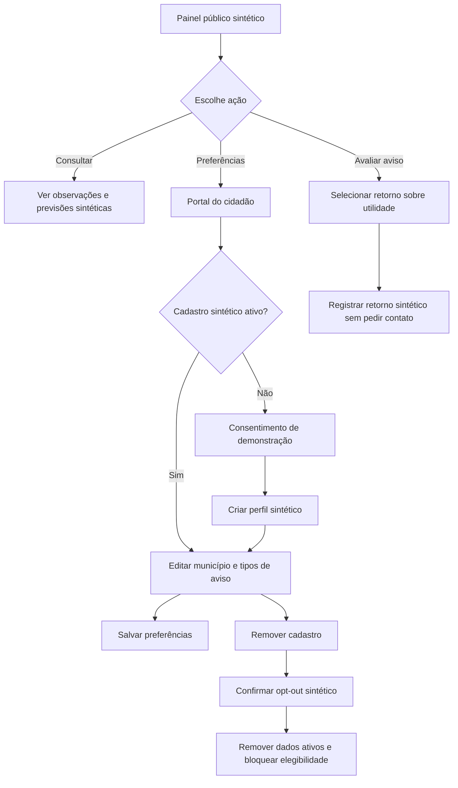
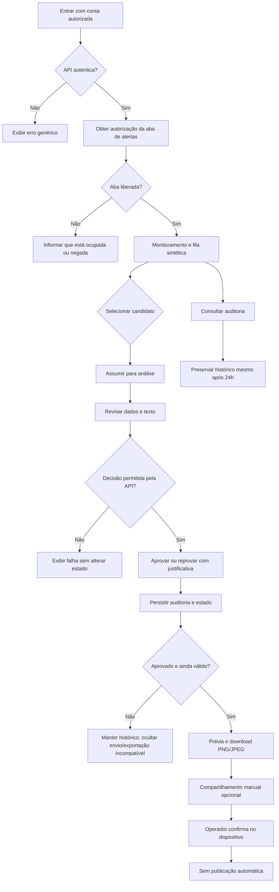
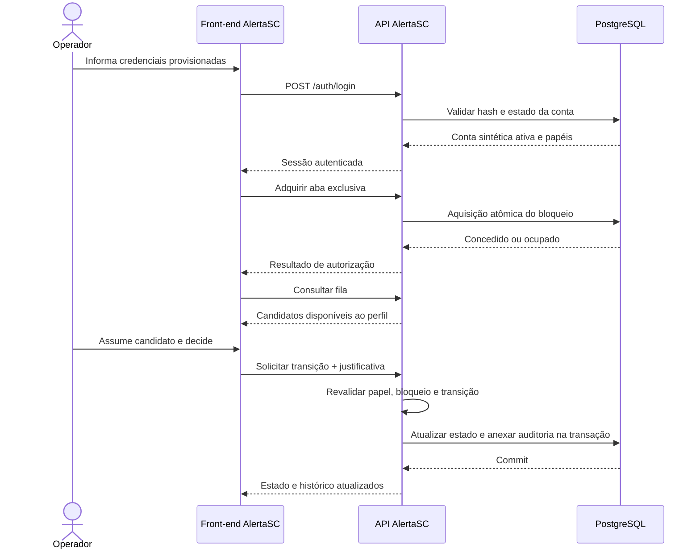
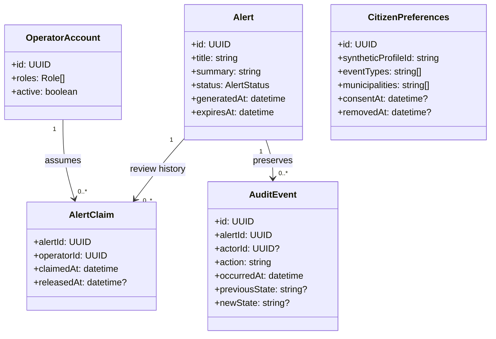
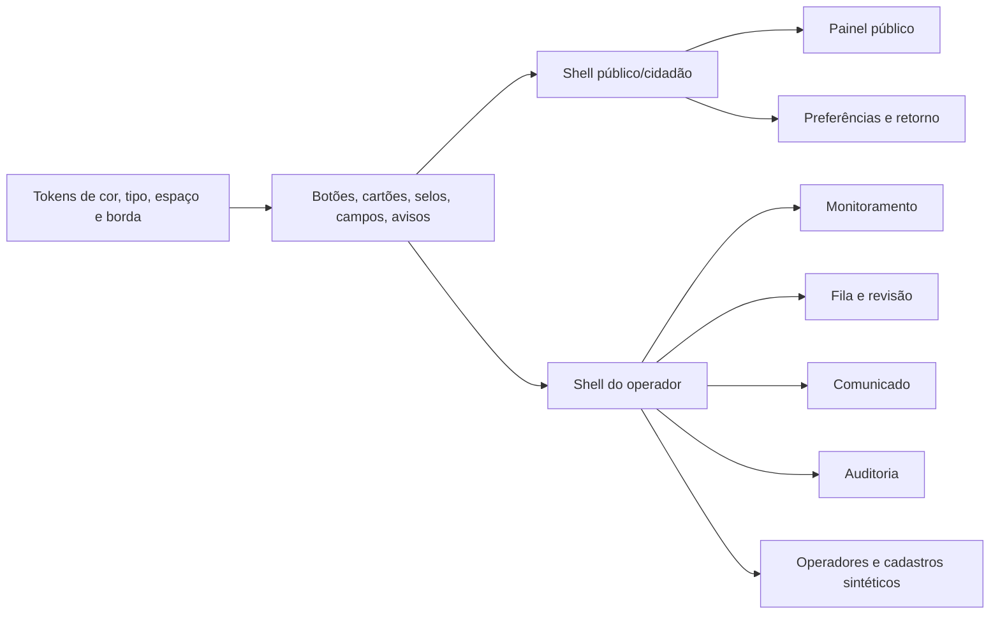

# Protótipo de fluxos e diagramas do front-end

Este material acompanha o [protótipo navegável](etapa-front-end.html) para revisão prevista na ALE-37. O protótipo usa apenas conteúdo sintético, mantém a marca textual AlertaSC e não conecta APIs, fontes oficiais, cadastros reais ou canais externos. Os diagramas representam o escopo aprovado e as telas previstas; não substituem os contratos técnicos das APIs.

## Atividade — cidadão

## Atividade — operador

## Sequência — autenticação e fila

## Modelo mínimo de apresentação

Os campos acima ilustram o contrato que as telas precisam apresentar. O protótipo não propõe migrações ou novas regras de persistência. O front-end deve tratar permissões, estado e validade retornados pela API como autoridade; esconder controles não substitui autorização no servidor.

## Componentes de interface

## Pontos para revisão institucional

- Confirmar se a hierarquia do painel público deve priorizar observações, previsões e avisos aprovados nesta ordem.
- Revisar rótulos e densidade visual da fila e do detalhe de alerta.
- Confirmar se as preferências e o retorno do cidadão estão representados sem solicitar dados pessoais no protótipo.
- Revisar a navegação superior em computadores e a navegação inferior em celulares.
- Validar que a marca permanece apenas textual enquanto as logos oficiais não forem disponibilizadas/aprovadas.
- Após revisão, registrar comentários e pendências na ALE-37 antes de usar estes artefatos para guiar a implementação integrada.
